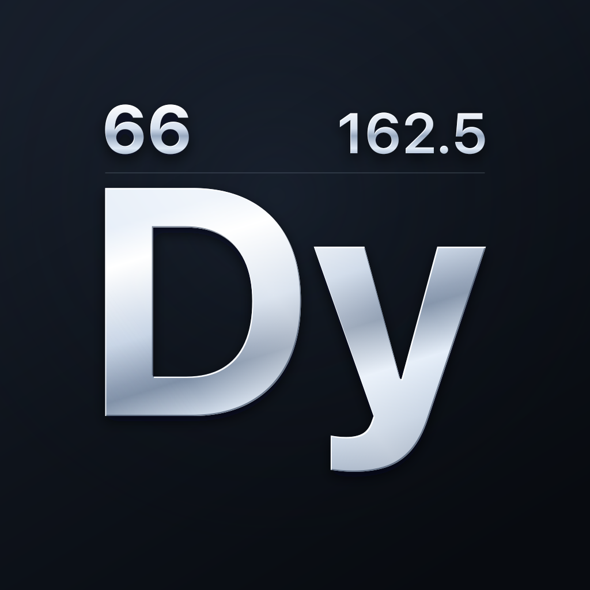

<p align="center">
  <picture>
    <source media="(prefers-color-scheme: dark)" srcset="DesignAssets/AppIconFinal/AppIcon-Dark.svg">
    <source media="(prefers-color-scheme: light)" srcset="DesignAssets/AppIconFinal/AppIcon-Light.svg">
    
  </picture>
</p>

<h1 align="center">Dysprosium (Dy)</h1>

<p align="center">
  <strong>A LiveContainer-native iOS 27.2 cleanroom WebKit browser, multi-profile workspace, live Media Radar, native PDF reader, and parallel range downloader engineered for iPhone Duo and Liquid Glass.</strong>
</p>

<p align="center">
  <a href="LICENSE"></a>
  <a href="https://github.com/benjipeng/dysprosium/actions/workflows/ci.yml"></a>
  <a href="https://github.com/benjipeng/dysprosium/releases/latest"></a>
  
  
  
</p>

<p align="center">
  <a href="#highlights">Highlights</a> ·
  <a href="#iphone-duo--liquid-glass">iPhone Duo</a> ·
  <a href="#installation-livecontainer">Installation</a> ·
  <a href="#building-from-source">Building</a> ·
  <a href="#architecture--roadmap">Architecture</a> ·
  <a href="#acknowledgments">Acknowledgments</a>
</p>

---

## Highlights

- **Cleanroom WebKit Browser**
  Multi-tab browsing backed by SQLite FTS5 history and bookmarks, native `WKContentRuleList` ad and tracker blocking (chunked v10 compiler with ABP/uBO filter subscriptions and scriptlets), a 0-frame Fingerprint Shield, and Dark Reader CSSOM/HSL theming (`OLED #000000`, Obsidian, Graphite, Warm Paper).
- **Multi-Profile Browsing**
  Up to 6 persistent, isolated profiles alongside orthogonal ephemeral Private Browsing. Each profile owns a dedicated `WKWebsiteDataStore`, tabs, SQLite history and bookmarks, site rules, search engine, User-Agent preset, Lanthanide accent palette, and cryptographic fingerprint seed.
- **Live Media Radar & Parallel Transfer Engine**
  Domain-agnostic playback and MIME stream sniffer with `SystemProxyBridge` parity, RFC 6265 cookie scoping, and cross-origin redirect credential stripping. Downloads run across multi-lane HTTP `Range` workers (`fcntl(F_PREALLOCATE)` + `pwrite`), native HLS (`.m3u8` / AES-128 / fMP4 / MPEG-TS) remuxing, and in-app Quick Look / `AVPlayerViewController` preview.
- **Native In-Tab `PDFKit` Reader**
  Renders PDFs directly inside browser tabs without forcing a download—complete with iPhone Duo Two-Up Book Spread across the center crease, single-pass hue-preserving Dark and Paper modes, outline and page navigation, search, encrypted PDF unlock, and one-tap Save Original.
- **Multi-Instance Shared Save Folder**
  Pick any user-visible folder in iOS Files via Security-Scoped Folder Bookmarks (per-host LiveContainer bookmark isolation, `NSFileCoordinator` atomic commits, and one-shot migration) so multiple LiveContainer hosts share one Downloads directory.

---

## iPhone Duo & Liquid Glass

Compiled natively against the **iOS 27.2 SDK**, Dysprosium adapts its top chrome, hardware vertical bar, and reading canvas across every iPhone Duo display posture:

| Posture | Canvas (`pt`) | Layout & Chrome Behavior |
| --- | --- | --- |
| **Outer Portrait** | `466 × 678` | Controls relocate to the `84 pt` hardware rail; floating omnibox hovers over a full-bleed `WKWebView`. |
| **Inner Portrait** | `669 × 951` | Persistent `36 pt` Liquid Glass omnibox shares the `82 pt` top band cleanly beside the corner status cluster. |
| **Inner Landscape** | `951 × 669` | Full-bleed widescreen viewport with `84 pt` hardware rail integration and scroll-linked top-pill collapse. |
| **Book Pose** | `40 pt` `.division` | Hinge-aware Two-Up `PDFKit` Book Spread and crease-safe layout geometry via `ReservedRegion`. |

Scroll-linked chrome uplifts fixed site navigation bars flush to `0 pt`, auto-hides the corner status cluster on scroll down, and coordinates directly with `TabView.tabBarMinimizeBehavior(.onScrollDown)`.

---

## Installation (LiveContainer)

Official unsigned Release IPAs are built reproducibly on GitHub Actions (`xcode-27`, iOS `27.2` SDK) and published to [Releases](https://github.com/benjipeng/dysprosium/releases) for import into [LiveContainer](https://github.com/LiveContainer/LiveContainer):

1. Download the latest `Dysprosium-v*_b*.ipa` from [Releases](https://github.com/benjipeng/dysprosium/releases/latest).
2. Open **LiveContainer**, tap **+**, and import the `.ipa` (LiveContainer handles `MH_EXECUTE` → `MH_DYLIB` patching and ad-hoc signing automatically).
3. Launch **Dysprosium** from LiveContainer.

> [!TIP]
> **Multi-Instance Save Folder:** Open **Downloads › Choose Save Folder…** or **Engine & Host › Storage & Sandbox › Save Location** to pick a shared folder in Files (for example, `On My iPhone › Downloads`). When launching from a second host (`LiveContainer2`), tap **Grant Access…** once to authorize that same folder.

---

## Building from Source

### Requirements

- macOS with **Xcode 27.2** (iOS `27.2` SDK)
- Swift `6.0`

### Build Unsigned LiveContainer Release IPA

```bash
./scripts/build_livecontainer_ipa.sh
```

The script clears `SDKROOT`, archives `Release` for `generic/platform=iOS`, verifies `vtool -show-build` reports `platform IOS` and `sdk >= 27.2`, and writes:

- `build/Dysprosium-v<marketing>_b<build>.ipa`
- `build/Dysprosium-LiveContainer.ipa`

### Run Test Suite (Simulator)

```bash
unset SDKROOT
xcodebuild test \
  -project Dysprosium.xcodeproj \
  -scheme Dysprosium \
  -destination 'platform=iOS Simulator,name=iPhone Duo' \
  -derivedDataPath DerivedData
```

> [!NOTE]
> **Optional External Frameworks:** Run `./scripts/bootstrap_frameworks.sh` to fetch QuickJS-NG and view drop-in instructions for optional `XCFramework` add-ons (`Python.xcframework`, `SwiftFFmpeg-iOS`, `SwiftCurlCffi-iOS`). Dysprosium compiles and runs its native Swift Range, HLS, and MP4 remux engines out of the box without them.

---

## Architecture & Roadmap

Dysprosium decouples resolution, transport, and remuxing into three isolated planes inside LiveContainer's single host process:

| Plane | Role |
| --- | --- |
| **Control Plane** | Fast-path probe, optional embedded `yt-dlp` / QuickJS-NG resolution, and immutable transfer plan emission. |
| **Data Plane** | Swift structured concurrency across multi-lane `pwrite` HTTP `Range` and AES-128 HLS transfers with SQLite WAL journaling. |
| **Post-Processing Plane** | Serialized `FFmpegMuxActor` for lossless `-c copy` audio/video remuxing. |

- Full runtime contracts, LiveContainer sandbox invariants, and SQLite WAL `0xdead10cc` suspension hardening live in [`ARCHITECTURE.md`](ARCHITECTURE.md).
- **Planned:** Native non-DRM MPEG-DASH (`.mpd`) manifest parser and paired video/audio fMP4 downloader (currently detected and labeled `DASH · Unsupported` in Media Radar).

---

## License

Dysprosium is released under the [MIT License](LICENSE). See [`THIRD_PARTY_NOTICES.md`](THIRD_PARTY_NOTICES.md) for bundled third-party components and licenses.

---

## Acknowledgments

⚫⚪🟡 Thanks to the vibrant community at **[Linux.do](https://linux.do)** for the inspiration, technical exchange, and open spirit that helped shape Dysprosium.

Dysprosium also stands on the shoulders of the [LiveContainer](https://github.com/LiveContainer/LiveContainer) project and the open-source maintainers credited in [`THIRD_PARTY_NOTICES.md`](THIRD_PARTY_NOTICES.md).
